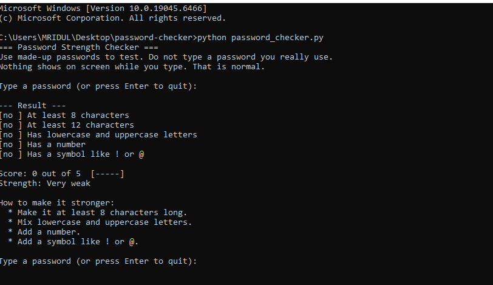
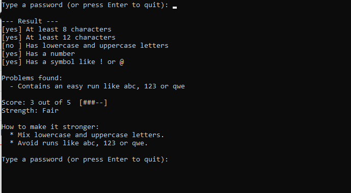
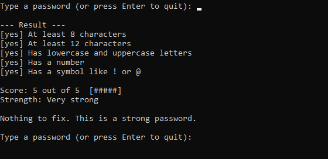

# Password strength checker

A small Python program that checks how strong a password is, points out weak habits, and tells the user what to change.

## Why I made it

I noticed that some of my older family members, especially my grandmother, do not have much knowledge about technology. They often use simple passwords that can be easily guessed or cracked. I wanted to create something that could help them check whether their passwords are strong enough and encourage them to use safer passwords. My long-term goal is to develop this into a proper, user-friendly application that anyone can use.

## What it does

- Checks five rules: at least 8 characters, at least 12 characters, both lowercase and uppercase letters, a number, and a symbol
- Gives a score out of 5 with a small bar, and a rating from "Very weak" to "Very strong"
- Takes points off for repeated characters (like `aaa`) and easy runs (like `abc`, `123` or `qwe`)
- Marks well-known passwords, like `password123`, as very weak
- Lists tips on how to make the password stronger
- Hides the password while it is typed, and never saves or sends it anywhere

## Screenshots

## How to run it

Install Python from python.org and put `password_checker.py` in a folder. Open a terminal in that folder and type `python password_checker.py`.

Nothing shows on screen while you type, so the password stays private. Please test with made-up passwords and not ones you really use.

## What was hard

The hardest part was understanding how to check different password conditions, such as length, uppercase and lowercase letters, numbers, and special characters. I also had to understand how to identify weak patterns in passwords.

## What I learned

I learned that a password can contain different types of characters and still be weak. For example, using predictable patterns like abc123 makes a password easier to guess. I also learned why hiding passwords while typing is important for privacy and security.

## What I would add next

If I had more time, I would turn this basic project into a proper password security application with a simple graphical interface, password suggestions, and more advanced security checks. I would especially focus on making it easy for older people like my grandmother to use, even if they have limited technical knowledge.

## A note on how I built it

I used an AI assistant as a guide while learning, and I tested and changed the program myself.
